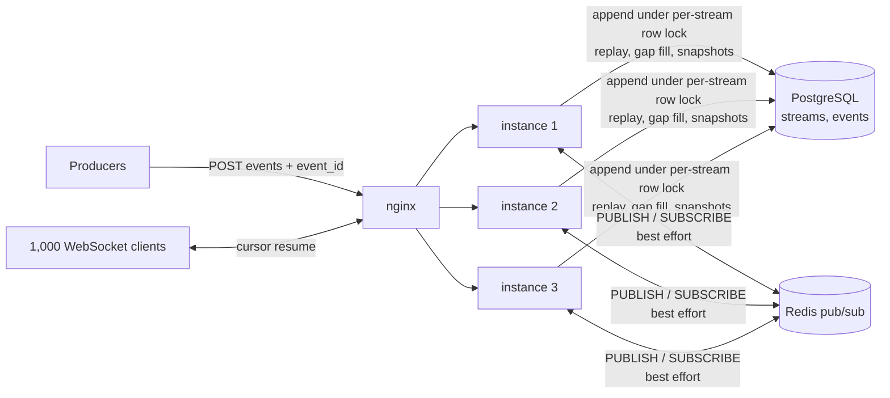

# livefeed: real-time event streaming

[](https://github.com/AnuragBhandary/Real-Time-Event-Streaming/actions/workflows/ci.yml)


A live event feed, demoed as a real-time cricket scoreboard with a React web app. Producers
publish events, PostgreSQL stores them in order, and every WebSocket subscriber on any instance
(a browser tab or the Python SDK) receives each event **exactly once, in order**. That holds
through reconnects, instance crashes, Redis failures and slow clients.

**Backend:** Python 3.12, asyncio, FastAPI + WebSockets, PostgreSQL (ordered log and snapshots),
Redis pub/sub (cross-instance fan-out), nginx, Docker, GitHub Actions.
**Frontend:** React 19, TypeScript, Vite, Tailwind CSS, TanStack Query, React Router; tested with
Vitest, Testing Library and Playwright.

### Measured results ([details](docs/BENCHMARKS.md))

| 1,000 WebSocket clients · 3 instances · 100,000 events · continuous chaos | |
|---|---|
| Deliveries | **5,000,000 / 5,000,000**; every client ended with every event |
| Duplicate or out-of-order events | **0** (measured at the protocol level) |
| Reconnects survived | **14,069**: random client drops, 5 instance SIGKILLs, 8 Redis pub/sub kills |
| Live delivery latency | **p95 5 ms**, p99 14.5 ms (producer send → subscriber receive) |
| Headroom (no chaos) | ≈ 50,000 deliveries/s at p95 71 ms |
| Browser end to end (Playwright, 4 runs) | **3 tabs per run all matched the server's final state** through 6 forced drops, 3 rolling restarts and a SIGKILL; tabs watching from the start applied **every one of 602–1,502 events exactly once** |

## How it works



- **Ordering.** Appends lock the stream's row, so `seq = last_seq + 1` is assigned in commit
  order. If seq N is visible, everything before it is too.
- **Fan-out.** After commit the event is published to Redis. Each instance forwards it to its
  local clients. The event is serialised once and the same bytes go to every client.
- **Pub/sub is allowed to fail.** Each instance tracks the last seq it delivered per stream. It
  drops duplicates and fills gaps from PostgreSQL. A 1-second resync loop catches lost final
  messages. Out-of-order delivery across instances is repaired the same way.
- **Race-free resume.** A reconnecting client is registered *before* its history replay, and
  live events are buffered meanwhile. Replay is paged, flow-controlled and **bounded**: a cursor
  more than 10,000 behind gets a snapshot instead.
- **Backpressure.** Each client has a bounded queue and its own writer task. A client that falls
  behind is closed with `4008` and resumes from its cursor. Memory stays bounded and other clients
  are never slowed. Producers get `429` (token bucket) or `503` (load shedding).
- **One recovery path.** Network drops, crashes, deploys (`1012`), slow consumers (`4008`) and
  detected gaps (`4009`) all end the same way: reconnect and resume from the cursor.

Full reasoning, alternatives and failure analysis: **[docs/DESIGN.md](docs/DESIGN.md)**.

## Quick start

```bash
docker compose up -d --build --wait     # PostgreSQL, Redis, 3 instances, nginx on :8080
make demo                               # simulated live matches
```

Open http://localhost:8080 for the web app: pick a match and watch it update live. API docs are at
http://localhost:8080/docs.

## Web app

`web/` is a React + TypeScript app that every instance serves at `/` (the Docker image builds it).

- **Matches** (`/`): live and finished matches with their scores, refreshed every 2 seconds.
- **Match** (`/m/<id>`): scoreboard, ball by ball feed and a connection panel that makes the
  guarantees visible: cursor, events applied, duplicates dropped, gaps resynced, reconnects,
  lag behind the server, ping, and why the last connection closed. **Simulate network drop**
  kills the socket so you can watch it resume.

The browser speaks the same protocol as the Python SDK through its own client,
[`web/src/feed/client.ts`](web/src/feed/client.ts). It keeps a cursor and accepts only seq =
cursor + 1, so it drops duplicates and treats any gap as a reason to reconnect from its cursor.
It reconnects straight away after a restart (`1012`) or a resync, and backs off exponentially with
jitter after network failures. A heartbeat watchdog detects dead connections, and it waits for the
browser's `online` event instead of retrying while offline. Joining mid-match gives a snapshot,
and the last 30 balls are fetched over REST to fill the feed. The TypeScript reducer must match the
Python one exactly. `tests/test_web_contract.py` writes the Python states for three simulated
matches, and `reducers.test.ts` replays them event by event.

```bash
make web-dev     # Vite on :5173 with hot reload, proxying /v1 to the stack on :8080
make web-test    # ESLint, tsc, 37 Vitest tests with a coverage gate
make e2e         # Playwright against the real stack, with chaos (about 1 minute)
```

### Python SDK

```python
from livefeed.client import Producer, Subscription

async with Producer("http://localhost:8080", api_key) as producer:
    await producer.create_stream("final-2026", kind="match")
    await producer.publish("final-2026", "match_started", {"teams": ["MI", "CSK"]})
    await producer.publish("final-2026", "score", {"team": "MI", "points": 6})  # retries are idempotent

async with Subscription(["ws://localhost:8080"], "final-2026") as sub:
    async for item in sub:        # Snapshot first, then Events with consecutive seq numbers
        print(item)               # survives disconnects: resumes from its cursor automatically
```

### API

| | | |
|---|---|---|
| `POST` | `/v1/streams` | Create a stream (`generic` or `match`) |
| `GET` | `/v1/streams?kind=&limit=` | Recently active streams, newest first |
| `POST` | `/v1/streams/{id}/events` | Append 1-500 events atomically; `event_id` makes retries idempotent |
| `GET` | `/v1/streams/{id}` | Snapshot: materialised state + the seq it reflects |
| `GET` | `/v1/streams/{id}/events?after=&limit=` | History / HTTP catch-up |
| `WS` | `/v1/streams/{id}/ws?cursor=` | Live subscription (snapshot or replay, then live) |
| `GET` | `/healthz`, `/readyz`, `/metrics`, `/v1/instance` | Ops |

WebSocket frames: `snapshot`, `events` (`replay: bool`, consecutive `items`), `heartbeat`
(`seq`, `head`), `pong`. Close codes: `4004` unknown stream, `4008` slow consumer, `4009` resync,
`1012` restart.

## Testing

```bash
make infra && make check    # ruff, mypy, 64 Python tests (93% coverage)
make web-test               # ESLint, tsc, 37 web tests (98% lines)
make e2e                    # Playwright: 3 browser tabs through drops, restarts and a SIGKILL
make load-smoke             # 1-minute load test with every kind of chaos
```

The tests use real PostgreSQL, Redis and uvicorn servers, including three instances in one test.
They cover:
- **Pub/sub repair:** lost, duplicated and reordered messages; killed pub/sub connections.
- **Clients:** joins racing a live publisher; a raw TCP client that never reads (cut off with
  `4008` while others are unaffected).
- **Chaos:** SIGKILL of real server processes mid-stream (`tests/test_chaos.py`).
- **Browser:** the web client against a scripted fake socket (gaps, duplicates, backoff timing,
  heartbeat timeouts, offline/online); pages with Testing Library; and Playwright end to end,
  where three tabs watch one match while one tab's connection is dropped six times, every
  instance is restarted and one is SIGKILLed. Each tab must end with the server's exact state.

## Layout

```
src/livefeed/
  repository.py   append (row lock, idempotency, reducer), replay, heads
  hub.py          Channel (dedupe, gap fill, resync), Session (queue, writer, 4008/4009), join
  bus.py          Redis pub/sub publish + resilient subscriber
  protocol.py     wire formats, close codes
  api/            FastAPI routes, auth, rate limiting, load shedding
  client.py       Subscription (cursor resume) and Producer (idempotent retries)
  reducers.py     snapshot state machines (generic, cricket match)
  simulator.py    live match generator
web/src/
  feed/client.ts  browser subscription: cursor, dedupe, gap resync, backoff, heartbeat watchdog
  feed/reducers.ts TypeScript port of the reducers (contract-tested against Python)
  pages/          match list, live match page
  components/     scoreboard, ball by ball feed, connection panel
web/e2e/          Playwright chaos test against the running stack
bench/loadtest.py 1,000-client load + chaos harness with protocol-level auditing
docs/             DESIGN.md · BENCHMARKS.md
```
